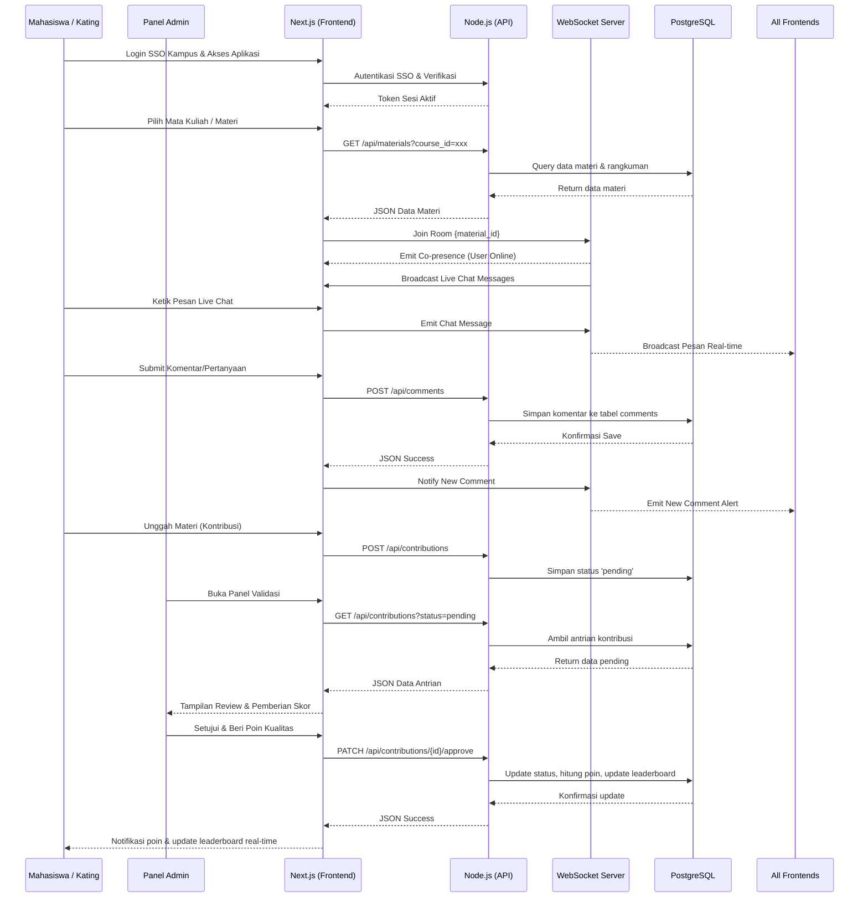
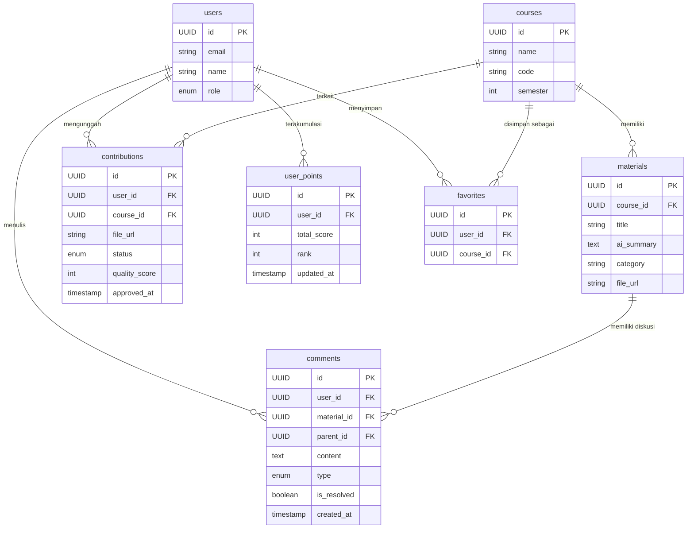

# PRD — Project Requirements Document

## 1. Overview
Aplikasi ini adalah sebuah platform web berbasis edukasi yang dirancang untuk menggantikan tradisi "Google Drive Kating (Kakak Tingkat)". Mahasiswa baru sering kali merasa kebingungan dengan jurusannya, kesulitan memahami materi slide (PPT) dari dosen, tidak memiliki akses ke latihan soal UTS/UAS tahun sebelumnya, dan tidak memiliki koneksi ke kating untuk mendapatkan tautan *drive* berkualitas.

Tujuan utama dari aplikasi ini adalah menjadi portal "Master Drive" yang terstruktur, rapi, dan cepat. Aplikasi ini memungkinkan mahasiswa untuk menelusuri mata kuliah dari semester 1 hingga 6 secara instan. Nilai jual utamanya adalah penyediaan materi yang sudah diringkas secara komprehensif oleh AI, menggantikan format file statis yang kaku, sehingga belajar menjadi lebih mudah, fokus, dan efektif. Dengan penambahan sistem gamifikasi berbasis poin dan validasi admin, aplikasi ini bertujuan membangun ekosistem berbagi ilmu yang berkelanjutan dengan mendorong partisipasi aktif dari mahasiswa senior/kating. Seluruh akses aplikasi diamankan dan disederhanakan melalui autentikasi SSO Kampus.

Selain itu, aplikasi ini kini dilengkapi dengan **Collaborative Learning Hub** yang memungkinkan interaksi sosial real-time. Pengguna dapat melihat siapa saja yang sedang mengakses materi yang sama, berdiskusi via live chat, atau meninggalkan pertanyaan dan tips secara persisten, menciptakan pengalaman belajar kolaboratif yang dinamis dan terintegrasi.

## 2. Requirements
- **Aksesibilitas Tinggi:** Aplikasi berbasis web yang responsif (nyaman dibuka di laptop maupun HP) tanpa harus mengunduh file satu per satu.
- **Navigasi Terstruktur:** Konten harus dikelompokkan secara logis berdasarkan tingkatan semester (Semester 1 - 6).
- **Kinerja Cepat:** Pencarian mata kuliah dan bongkar-muat halaman materi (rangkuman AI) harus instan.
- **Manajemen Konten Terpusat:** Sistem harus memungkinkan *admin* untuk mengunggah materi, latihan soal, dan teks rangkuman AI dengan mudah ke dalam database sentral.
- **Autentikasi SSO Kampus:** Login terintegrasi langsung menggunakan identitas SSO kampus (OAuth2/OIDC) untuk memverifikasi status mahasiswa secara otomatis, meminimalkan hambatan masuk, dan menjaga keamanan akun.
- **Mekanisme Poin Berbasis Kualitas:** Sistem perhitungan poin yang tidak hanya berdasarkan kuantitas unggahan, tetapi juga penilaian kualitas manual dari admin terhadap relevansi dan kelengkapan file.
- **Keamanan Data & Validasi Konten:** Setiap kontribusi user melewati tahap review admin untuk memastikan file bebas malware, tidak melanggar hak cipta, dan sesuai dengan kebijakan akademik sebelum dipublikasikan.
- **Interaksi Real-time:** Komunikasi instan antar pengguna yang sedang membuka halaman materi yang sama tanpa perlu refresh halaman.
- **Persistensi Diskusi:** Fitur komentar dan thread pertanyaan yang tersimpan permanen untuk membantu pengguna berikutnya dan membangun知识库 (knowledge base) komunitas.
- **Indikator Co-presence:** Menampilkan jumlah atau identitas pengguna yang sedang aktif membaca materi yang sama secara real-time untuk memicu diskusi spontan.

## 3. Core Features
- **Pencarian Cepat (Quick Search):** Fitur pencarian *real-time* untuk menemukan mata kuliah dengan cepat hanya dengan mengetikkan nama atau kode mata kuliah (*First Win* bagi pengguna).
- **Rangkuman AI Komprehensif:** Halaman khusus untuk setiap mata kuliah yang berisi penjelasan mendalam dan ringkasan materi yang sudah diolah oleh AI, sehingga mahasiswa tidak perlu lagi pusing membaca PPT mentah.
- **Arsip Bank Soal & Referensi Ujian:** Direktori terstruktur yang menyediakan kumpulan kuis dan latihan soal dari tahun-tahun sebelumnya.
- **Simpan Favorit (Bookmark):** Pengguna dapat menyimpan mata kuliah atau bab materi tertentu ke dalam daftar favorit agar cepat diakses saat musim ujian tiba.
- **Tampilan Rapi & Modern (Clean UI):** Antarmuka yang terstruktur dan jauh lebih baik daripada tampilan tumpukan folder di Google Drive.
- **Kolaborasi Belajar Real-time (Collaborative Learning Hub):** Fitur yang menyatukan live chat dan indikator kehadiran (co-presence) pada setiap halaman materi.
- **Live Chat per Materi:** Ruang obrolan instan khusus untuk setiap mata kuliah/bab. Hanya pengguna yang sedang membuka halaman tersebut yang dapat melihat dan mengirim pesan, menjaga relevansi diskusi.
- **Thread Diskusi & Komentar:** Area persisten di bawah rangkuman AI untuk meninggalkan pertanyaan, tips, atau catatan tambahan yang bisa dijawab oleh pengguna lain atau admin. Diskusi ini tetap tersimpan meski pengguna keluar dari halaman.
- **Kontribusi Terstruktur (User-Generated Content):** Fitur bagi mahasiswa/kating untuk mengunggah materi, rangkuman, atau bank soal melalui dashboard khusus kontributor.
- **Panel Validasi Admin (Review Queue):** Ruang bagi admin untuk meninjau, menyetujui, menolak, dan memberikan *quality score* pada setiap kontribusi yang masuk sebelum dipublikasikan.
- **Sistem Gamifikasi & Poin:** Poin diberikan secara otomatis setelah kontribusi disetujui, dihitung berdasarkan skor kualitas yang ditetapkan admin, dan terakumulasi ke profil user.
- **Leaderboard Real-time:** Halaman peringkat publik yang menampilkan kontributor teratas berdasarkan akumulasi poin kualitas untuk mendorong persaingan positif dan motivasi berbagi ilmu.

## 4. User Flow
1. **Akses & Autentikasi:** Mahasiswa baru mengunjungi website. Untuk akses penuh atau kontribusi, pengguna login menggunakan SSO Kampus. Akses baca materi dasar tetap tersedia tanpa login.
2. **Pencarian / Navigasi:** Pengguna memilih "Semester 1" atau menggunakan kolom pencarian untuk mencari mata kuliah (misal: "Dasar Pemrograman").
3. **Mengkonsumsi Materi & Kolaborasi:** Pengguna masuk ke halaman mata kuliah. Sistem secara otomatis menghubungkan ke *live chat* dan menampilkan indikator *co-presence* (jumlah user online). Pengguna membaca rangkuman AI, melihat indikator siapa yang sedang belajar materi yang sama, dan dapat langsung bertanya di chat.
4. **Meninggalkan Diskusi Persisten:** Jika memiliki pertanyaan mendalam atau tips ujian, pengguna mengetikkannya di area *Thread Diskusi & Komentar*. Komentar tersimpan ke database dan muncul sebagai notifikasi real-time bagi pengguna lain di halaman yang sama.
5. **Menyimpan Favorit:** Karena merasa materi tersebut penting, pengguna menekan tombol "Simpan Favorit".
6. **Retensi (Kembali lagi):** Pengguna kembali lagi ke website minggu depannya untuk membaca rangkuman materi bab baru, melihat balasan di komentar, atau mempersiapkan kuis.
7. **Kontribusi & Gamifikasi:** Mahasiswa senior mengakses halaman unggah, mengirim materi/ringkuman, dan status berkontribusi menjadi `pending`. Admin melakukan validasi, memberikan persetujuan, dan menetapkan skor kualitas. Setelah disetujui, poin user bertambah secara otomatis dan posisi di *Leaderboard Real-time* diperbarui secara instan.

## 5. Architecture
Aplikasi ini menggunakan arsitektur *Client-Server* modern yang diperkuat dengan komunikasi *real-time*. Frontend (Next.js) menangani antarmuka dan interaksi pengguna. Komunikasi data utama dilakukan via REST API ke Backend (Node.js), sementara fitur live chat dan co-presence ditangani secara khusus oleh **WebSocket Server** yang berjalan terintegrasi atau terdistribusi di samping Backend. Backend mengambil data materi, rangkuman AI, struktur semester, dan komentar dari Database (PostgreSQL) sebelum mengembalikannya ke pengguna. Sistem WebSocket mengelola broadcast pesan secara efisien tanpa membebani database untuk trafik chat yang tinggi. Autentikasi tetap ditangani via provider SSO Kampus yang terintegrasi.

## 6. Database Schema
Sistem ini membutuhkan beberapa tabel utama untuk mengatur pengguna, mata kuliah, materi, komentar persisten, sistem favorit, serta alur kontribusi, validasi, dan gamifikasi.

**Tabel `users`**
- `id` (UUID, Primary Key) - ID unik pengguna
- `email` (String) - Email pengguna (dari SSO)
- `name` (String) - Nama pengguna
- `role` (Enum: 'user', 'admin') - Hak akses sistem

**Tabel `courses`**
- `id` (UUID, Primary Key) - ID unik mata kuliah
- `name` (String) - Nama mata kuliah (Misal: Aljabar Linear)
- `code` (String) - Kode mata kuliah
- `semester` (Integer) - Kategori semester (1-6)

**Tabel `materials`**
- `id` (UUID, Primary Key) - ID unik materi
- `course_id` (UUID, Foreign Key) - Relasi ke tabel courses
- `title` (String) - Judul materi/bab
- `ai_summary` (Text) - Teks panjang berisi rangkuman komprehensif hasil AI (mendukung Markdown/HTML)
- `category` (String) - Jenis materi (Rangkuman, UTS, UAS, Kuis)
- `file_url` (String, Optional) - Link ke file asli (jika ada PDF/PPT referensi)

**Tabel `comments`**
- `id` (UUID, Primary Key) - ID unik komentar
- `user_id` (UUID, Foreign Key) - Penulis komentar
- `material_id` (UUID, Foreign Key) - Materi terkait
- `parent_id` (UUID, Optional) - Untuk fitur reply/thread
- `content` (Text) - Isi komentar/pertanyaan/tips
- `type` (Enum: 'comment', 'question', 'tip') - Kategori jenis interaksi
- `is_resolved` (Boolean, Default: false) - Penanda jika pertanyaan sudah terjawab
- `created_at` (Timestamp) - Waktu pembuatan

**Tabel `contributions`**
- `id` (UUID, Primary Key) - ID unik kontribusi
- `user_id` (UUID, Foreign Key) - Pengunggah kontribusi
- `course_id` (UUID, Foreign Key) - Mata kuliah terkait
- `file_url` (String) - Lokasi file yang diunggah
- `status` (Enum: 'pending', 'approved', 'rejected') - Status validasi admin
- `quality_score` (Integer, Default 0) - Poin kualitas yang diberikan admin (misal: 10-50 poin)
- `approved_at` (Timestamp) - Waktu persetujuan

**Tabel `user_points`**
- `id` (UUID, Primary Key) - ID unique record poin
- `user_id` (UUID, Foreign Key) - Pemilik poin
- `total_score` (Integer) - Akumulasi poin kualitas
- `rank` (Integer) - Peringkat di leaderboard
- `updated_at` (Timestamp) - Waktu pembaruan terakhir

**Tabel `favorites`**
- `id` (UUID, Primary Key) - ID unik favorit
- `user_id` (UUID, Foreign Key) - Pemilik favorit
- `course_id` (UUID, Foreign Key) - Mata kuliah yang disimpan

## 7. Tech Stack
Berikut adalah rekomendasi teknologi berdasarkan input spesifik, dilengkapi dengan alat bantu standar industri yang cocok agar pengembangan lebih cepat:

- **Frontend:** **Next.js** (App Router disarankan untuk performa SEO dan struktur yang baik), **Tailwind CSS** (untuk styling cepat), dan **shadcn/ui** (untuk komponen UI yang rapi dan siap pakai).
- **Backend:** **Node.js** (Bisa dipadukan dengan *Express.js* atau langsung menggunakan *Next.js API Routes* jika ingin menyatukan kode base / di-monorepo).
- **Database:** **PostgreSQL** (Relasional database tangguh untuk mengelola teks rangkuman dan relasi data). Disarankan menggunakan **Prisma** atau **Drizzle ORM** untuk interaksi Node.js ke PostgreSQL agar lebih mudah dan *type-safe*.
- **Komunikasi Real-time:** **Socket.io** atau **Pusher** (Untuk WebSocket) guna menangani live chat, indikasi co-presence, dan notifikasi komentar secara efisien tanpa perlu polling atau refresh halaman.
- **Autentikasi:** **SSO Kampus (OAuth2/OpenID Connect)** diimplementasikan menggunakan **NextAuth.js (Auth.js)** atau library serupa yang mendukung alur SSO enterprise/edukasi, memastikan identitas mahasiswa terverifikasi otomatis.
- **Deployment:** **Vercel** (Sangat optimal untuk setup Next.js + Node.js API serverless dengan CI/CD yang berjalan otomatis). *Database PostgreSQL bisa di-host via Supabase, Neon, atau Vercel Postgres*. *WebSocket server dapat di-deploy secara terpisah atau di-manage via Pusher/Ably untuk menghindari kompleksitas scaling Node.js WS.*